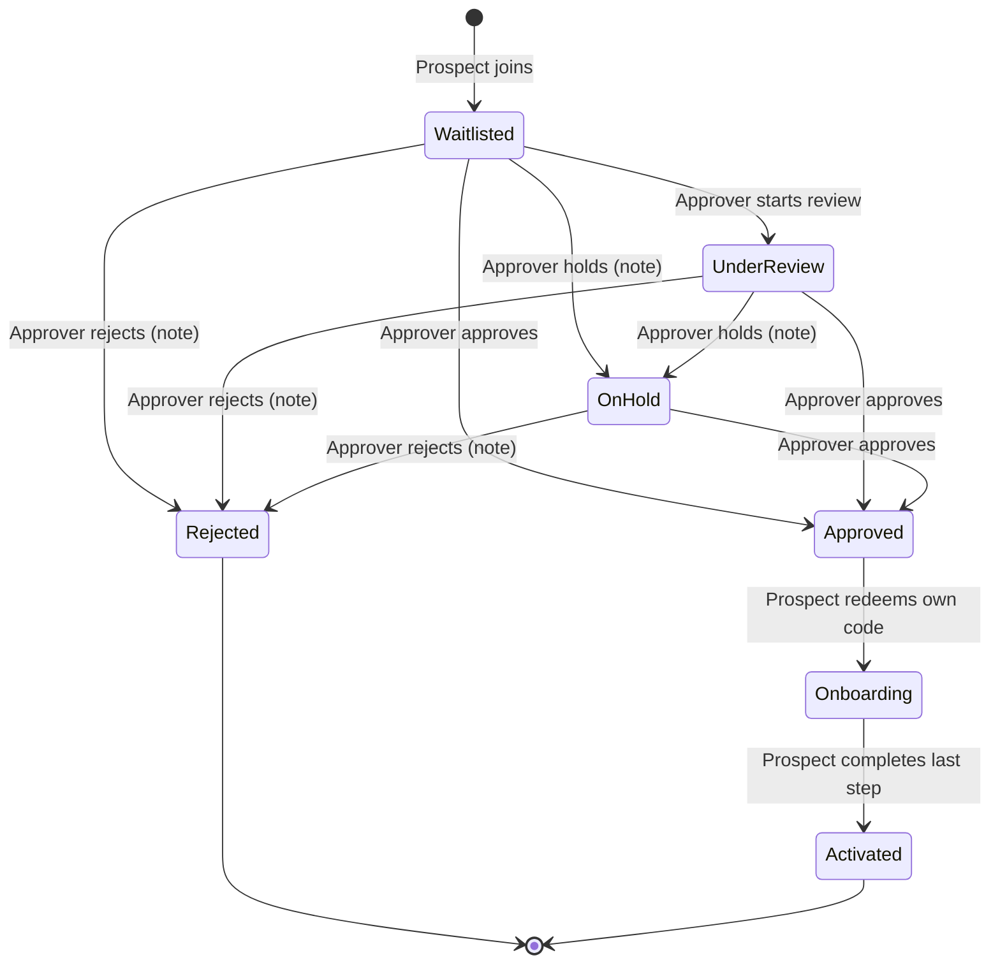

# Funnel status diagram and rules

`transition()` in [funnelService.js](../assets/js/logic/funnelService.js) is the only code that changes a status. Any move not drawn here is refused with `ERR_INVALID_TRANSITION`.

## Preconditions

| Move to | Who | Also requires | Otherwise |
| --- | --- | --- | --- |
| Under Review | Approver | | `ERR_FORBIDDEN` for other roles |
| Approved | Approver | A seat left in the current batch | `ERR_CAPACITY_FULL` |
| On Hold, Rejected | Approver | A note of at least 10 characters | `ERR_NOTE_REQUIRED` |
| Onboarding | Prospect, own entry | A redeemed code on this entry | `ERR_CODE_INVALID` |
| Activated | Prospect, own entry | All four steps complete | `ERR_STEP_ORDER` |

## Approval rules

- Seats used = entries in the batch that are Approved, Onboarding or Activated. This is calculated every time and never stored.
- Capacity is a whole number from 1 to 500, and can't go below the seats already used.
- Approval issues exactly one code, valid for 7 days and usable once. A code is expired from the exact moment of `expiresAt`.
- An approver may reissue an expired, unused code. This voids the old code, so each prospect has one live code at most.
- Redeeming needs a code that matches the prospect's own entry, is unused, isn't void and hasn't expired.
- Onboarding steps complete in order, and a completed step can't be redone.
- Every decision, status change and blocked attempt writes an audit event, and no function edits or deletes one.
